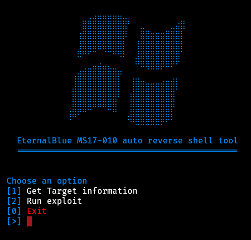

# bluepwn-ms17-010

Bash script that automates the process of creating and uploading a reverse shell to a windows 7/2008 R2 vulnerable to ms17-010

**install impacket before proceeding**

Host enumeration uses [NetExec](https://github.com/Pennyw0rth/NetExec) (`nxc`). The script auto-installs it via `pipx`/`pip` if it's not already on your `$PATH`; alternatively install it yourself with `pipx install netexec`.

Tested on Kali Linux 6.6.15

